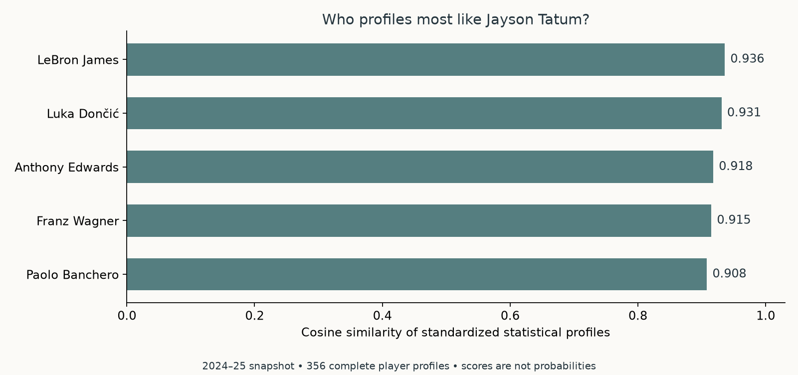
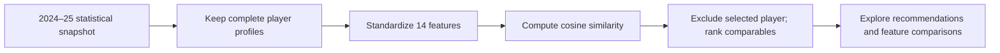
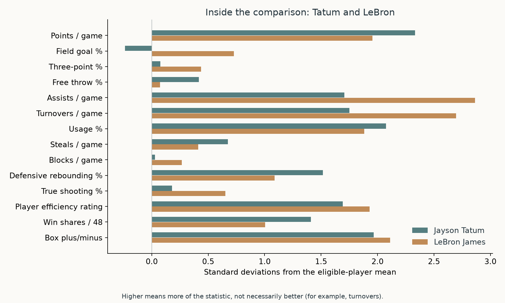
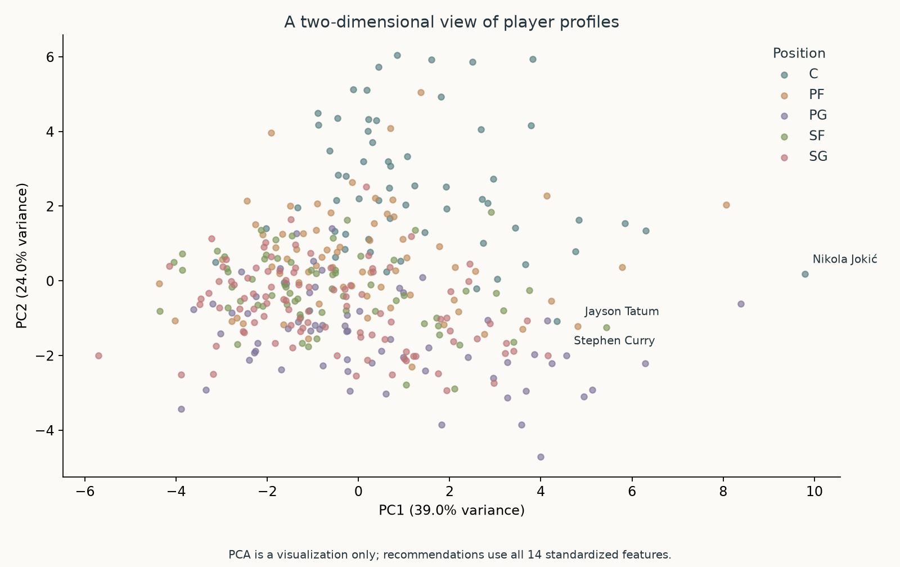

# NBA Player Similarity Recommender

### Find statistical comparables. Explore what makes them similar.

**2024–25 season · 356 eligible players · 14 statistical features**

Which players have comparable scoring, playmaking, defensive, and efficiency
profiles? This content-based recommender represents each player as a statistical
vector, standardizes the features, and ranks other players by cosine similarity.

An interactive Streamlit app lets you choose a player, explore their nearest
comparables, inspect the closest features, and compare profiles on a radar chart.

[Example recommendations](#an-example-jayson-tatum) · [How it works](#how-it-works) ·
[Player map](#explore-the-player-landscape) · [Run the app](#run-locally)



## An example: Jayson Tatum

The bundled snapshot produces these five nearest profiles:

| Player | Position | Cosine similarity |
| --- | --- | ---: |
| LeBron James | SF | 0.936 |
| Luka Dončić | PG | 0.931 |
| Anthony Edwards | SG | 0.918 |
| Franz Wagner | SF | 0.915 |
| Paolo Banchero | PF | 0.908 |

These scores describe resemblance in the selected statistics. A score of 0.936
does **not** mean a player is “93.6% as good,” a 93.6% match probability, or an
equivalent roster replacement. Positions are displayed but do not constrain ranking.

The example is generated from the included CSV and saved in
[`results/tatum_recommendations.csv`](results/tatum_recommendations.csv).

## How it works



### Represent a player's statistical profile

| Dimension | Included features |
| --- | --- |
| Scoring and shooting | Points/game, field-goal %, three-point %, free-throw % |
| Playmaking and usage | Assists/game, turnovers/game, usage % |
| Defensive statistics | Steals/game, blocks/game, defensive rebounding % |
| Efficiency and impact | True-shooting %, PER, win shares/48, box plus/minus |

The source pipeline combines per-game, per-100-possession, and advanced tables.
The current similarity model uses the 14 per-game/advanced features listed above;
the additional per-100 columns are available in the snapshot but are not used
in ranking.

### Put features on a comparable scale

`StandardScaler` expresses each feature relative to the eligible-player mean
and standard deviation. This prevents a feature's original numeric units from
determining its influence. Feature groups are not separately weighted; correlated
statistics can still influence the ranking more than once.

### Rank by cosine similarity

For standardized player vectors, cosine similarity measures alignment:

```text
similarity(a, b) = dot(a, b) / (norm(a) × norm(b))
```

Higher values indicate more similarly directed profiles relative to the player
pool. Negative scores are possible after centering. The method compares vector
direction rather than requiring identical statistical magnitude.

## Look inside a recommendation



*Zero represents the eligible-player mean. Positive values mean more of a
statistic, not universally better performance—turnovers are an obvious example.*

The app shows the six features with the smallest standardized absolute
differences. It also displays each feature's normalized contribution to cosine
similarity. All 14 contributions sum to the full score before display rounding;
the six closest features alone need not sum to that score.

The radar chart uses a separate **min–max normalization for display**. It does
not replace the standardization used by the recommender.

## Explore the player landscape



PCA projects the standardized feature matrix into two dimensions. The first two
components represent approximately **63% of feature variance** in this snapshot.
The map offers an overview of profile patterns, while the recommendation scores
continue to use all 14 features. Nearby dots are not guaranteed to be nearest
neighbors under the full cosine metric.

## Run locally

Use Python 3.12. From the repository root:

```bash
python3 -m venv .venv
source .venv/bin/activate
python -m pip install -r requirements.txt
python -m streamlit run app/app.py
```

On Windows, activate the environment with `.venv\Scripts\activate`.

The cleaned dataset is included, so the app does not need to scrape a website
or call a live API to make recommendations.

To use the recommender directly:

```python
from src.recommender import recommend, explain_similarity

print(recommend("Jayson Tatum", top_n=5))
print(explain_similarity("Jayson Tatum", "LeBron James"))
```

To explore the notebook, install JupyterLab, launch it from the root, and open
[`NBA_Player_Similarity_Recommender.ipynb`](notebooks/NBA_Player_Similarity_Recommender.ipynb):

```bash
python -m pip install jupyterlab
python -m jupyterlab
```

To recreate the README charts and example outputs:

```bash
python src/generate_visuals.py
```

## Data and scope

The **364-row historical snapshot** comes from the original Basketball Reference
data-preparation workflow. It applies a 500 estimated season-minutes threshold.
Eight rows have missing values in the selected features, leaving **356 eligible
profiles**. The app only offers players who can be scored.

See [`data/README.md`](data/README.md) for provenance, coverage, and optional
refresh instructions. This is a fixed 2024–25 snapshot, not current-season data.

## Limitations and next steps

- **Similarity is not player value or team fit.** Contracts, age, availability,
  lineup interactions, and scouting observations are outside the model.
- **Coverage depends on complete statistics.** Dropping missing shooting rates
  can exclude players with no attempts. Minutes filtering and traded-player
  aggregation also affect the comparison pool.
- **Feature selection shapes the answer.** Correlated impact and scoring
  metrics can dominate; role-specific or user-selected weights would be useful.
- **No recommendation-quality benchmark is claimed.** The examples demonstrate
  the computation, not validated scouting accuracy or improved basketball outcomes.

Potential extensions include weighted feature groups, position/role filters,
multi-season profiles, stability checks under alternative feature sets, and
expert-reviewed comparable-player lists.

## Project structure

```text
app/app.py              Streamlit interface
src/recommender.py      Similarity model and comparison helpers
src/data_prep.py        Optional source-table refresh pipeline
src/generate_visuals.py Reproducible README charts and examples
data/                   Historical cleaned snapshot and provenance notes
notebooks/              Snapshot-based exploratory workflow
figures/                README charts
results/                Example recommendations and PCA coordinates
tests/                  Ranking, explanation, and data-handling checks
```

Run the regression checks:

```bash
python -m unittest discover -s tests -v
```

The package was checked against all 356 eligible players, including self-exclusion
and sorted recommendations. Streamlit's initial render and player selection,
and the notebook's code cells, were also exercised. See
[`docs/CLEANUP.md`](docs/CLEANUP.md) for changes and verification details.
